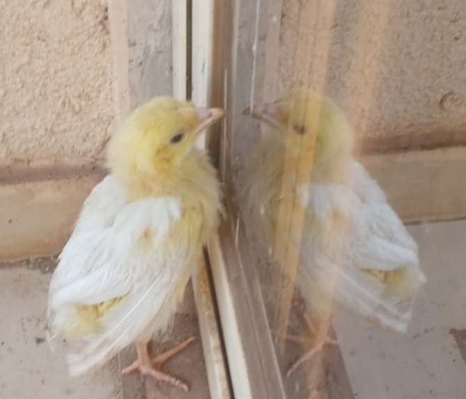

Life in Mumbai has often surprised me in the most unexpected ways. Amidst the city’s **crowd, chaos, cacophony and crazy lifestyle**, I have come across some fleeting moments of **compassion, care, candescence, charm and calmness**. They are like quiet pauses that remind one of the gentler side of existence in this bustling *City of Dreams*. One such moment came to me on an ordinary night, in my own balcony.

A small chick fell into the balcony of my flat last night. I don’t know whether it fell from one of the flats above mine, or escaped from the claws of some preying bird and fell into my balcony. Thankfully, it wasn’t hurt. The balcony is adjacent to my kitchen, and since the sliding glass door between them was open, the chick slowly walked in, clucking softly as it made its way into my kitchen.

I could not understand what it was trying to say, but its dishevelled feathers and uncertain gait made it clear that it needed **warmth, care, and a little food**. At that late hour, all I could find was a cardboard box. When I reached out to pick it up, it didn’t struggle or try to escape. Instead, it **nestled gently into my palms**.

I could feel its tiny heartbeat racing and noticed that it was breathing through its slightly open beak. Its black, beady eyes were full of fear. I held it for a while, speaking softly in my own language, hoping it would somehow understand that I meant no harm.

To my surprise, it seemed to calm down and slowly closed its eyes. I took that as a sign of trust and immediately felt that quiet pride that comes when you become someone’s *unexpected saviour*. Carefully, I placed it inside the cardboard box, setting small bowls of water and rice beside it. That little box became her *makeshift home for the night.*

The next morning as I woke up from bed, the first thought that crossed my mind was about the little chick in the cardboard box. *Was she still there, was she still alive? Was she safe?*

I jumped out of bed and rushed to check. But the box was empty. The rice and water I had left inside were untouched. A wave of **disappointment, fear and guilt** washed over me. The saviour in me suddenly felt defeated, perhaps I had failed to protect her.

I looked around the large balcony, crowded with potted plants, hoping for a sign. Then I heard it, that familiar, soft clucking, as if to say, *“I’m here!”*

A sigh of relief escaped me. There she was – up and about already, not only safe, but full of life again, wandering around my little balcony garden, pecking cheerfully at leaves and roots. My heart felt light and happy, and I couldn’t help but smile from ear to ear. Strange, isn’t it, how something so small can light up your heart and make you feel a **renewed sense of purpose in life?**

I gave her some more titbits and fruit pieces to eat. She roamed from one end of the winding balcony to the other and sometimes even walked into the house, moving about confidently as though it now belonged to her. Whenever I watched her strutting on those thin, long legs, I couldn’t help but imagine her as a **supermodel**, the thought made me laugh involuntarily!

As I went about my daily chores, I kept checking on her from time to time. She seemed happy, as if she had just been freed from a confined space and was now delighting in all the open room she had to herself.

I decided to give her a name. Since it was the festival of **Dhanteras** that day, I named her **Dhanu**.

By the afternoon, after lunch, I stepped out into the balcony to check on Dhanu again. I saw her pacing from one side of the glass door to the other, watching her reflection as she moved. As she walked, her reflection followed, making it look as though there was another little chick on the other side of the glass.

At first, I smiled at her innocent mistake, but soon, a wave of **tenderness and sorrow** replaced my amusement. She stopped and stood face to face with the glass door, staring quietly at her own reflection. Then, she slowly settled down in the corner, very close to the reflection in the glass. The reflection in the glass seemed to settle beside her too, nudgingly close.

I don’t know what comfort she found in that silent companion, but she sat there snuggled up, as if resting beside one of her siblings, the ones she might have lived with before she landed in my balcony.

It was such a **heartwarming sight** that tears welled up in my eyes.

That night, as I thought of Dhanu and her reflection, a quiet truth dawned on me. Every living being in this world whether human or animal, big or small, longs for the **company of its own kind**. *Companionship is not just a human need; but an undeniable universal truth of life…*

In a city like Mumbai, where millions live side by side yet often feel alone, Dhanu’s silent yearning reminded me how deeply we all long for connection — that familiar voice, a kind glance, or even if it is a reflection as in the case of Dhanu, it seemed to understand and comfort. Perhaps, in some way, not just in this city of dreams, but all over the present tech-savvy world, we all are just looking for our own **reflection in the glass** - *to console, to care and to comprehend…*

**Author’s Note:**
> *Sometimes, the quietest visitors in our life, leave the deepest imprints on our hearts — reminding us, that compassion and connection are the real measures of being human.*

