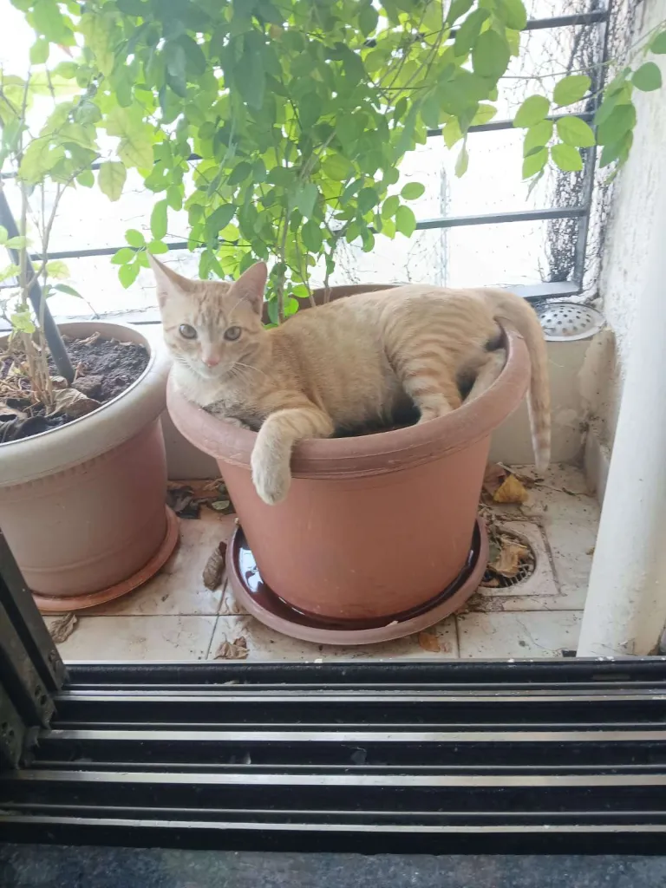

Some people in this world are born to give succour to others. I seem to be one of them, the difference being that, my succour is not for humans, but birds and animals. The lost & stray birds and animals somehow find their way to me. One rainy day, a tiny, scraggy little kitten strayed into my flat in Mumbai from somewhere and wouldn’t budge. I felt sorry for the little creature and gave it some warm milk to drink which it lapped up hungrily. The next step was giving it a place to rest. It was unkempt and looked as though it had been fending for itself. It also had fleas on it and was not vaccinated. Despite my soft corner for the creature, I decided against keeping it inside my small flat in its present condition. So I made a little arrangement for it in the balcony. There was a mango sapling growing in a large flowerpot. I wrapped a piece of cloth around the base of the plant and placed the kitten in it in a well sheltered corner of the balcony, safe from wind and rain. The kitten seemed to be fine with this arrangement and would curl itself around the little sapling and settle down to sleep in the flowerpot.

As the kitten continued to stay in my balcony, I took it to a vet, got it vaccinated, gave it baths, and fed it healthy food. Before long, the scraggy little creature had transformed into a healthy, happy kitten. It no longer had fleas, and I allowed it to roam around freely inside the house and sleep wherever it pleased. But I noticed that despite its newfound comfort and freedom, it did not abandon its little sleeping space in the flower pot. I would often find it returning to the flowerpot, curling itself around the mango sapling and settling down for a sound nap.

I was intrigued with its behavior as it had a comfortable home now. It had food, care, and protection. It no longer needed to seek shelter in a flowerpot. And yet, there it was, returning to the very place where it had found refuge when it was a tiny, vulnerable creature. I wondered what drew it back to that little corner. Was it the familiar smell, the shape of the pot, or the sense of security it had experienced there during those early days? I couldn't tell. But it definitely was touching to see that even when its circumstances had changed for the better, the cat (it was no longer a kitten) still found comfort and solace in the place where its journey had begun.

Seeing the cat’s behavior, I was reminded of Jeffrey Archer's bestselling novel, *Kane and Abel*, one of the books that established him as a celebrated storyteller. Abel Rosnovski rises from a life of poverty to become an immensely wealthy and powerful man. He acquires the kind of wealth that can buy almost anything imaginable. Yet, despite all his success, there is something he cannot quite change about himself, his sleeping habits. Having grown up in poverty, Abel finds his greatest comfort sleeping on the floor, without a pillow. Even when he can afford the finest beds and every imaginable luxury, he finds it difficult to sleep as comfortably in a bed as he does on the bare floor. *Isn't that fascinating?* His circumstances have changed, but some part of him still belongs to those early days.

Perhaps the familiarity of a comforting experience gets etched in one’s being. The kitten had its flowerpot. Abel had his bare floor….. The reverie brought back a childhood memory of “comfort food” of my mom. My mother would mix the left over rice and curry and make balls out of it and place one ball at a time on our outstretched palms until we children finished the complete left over food. Somehow these lumps of left-over food given by my mom tasted so much better than the fresh food that we had earlier. This memory has stayed with me long after the meals themselves have been forgotten. *Perhaps life’s pleasures are in the simplest of things.*

As we grow older, our lives change. We move into better homes, sleep on comfortable beds, eat at fancy restaurants, travel to distant places, and acquire things that our younger selves could only dream of. We become accustomed to comforts that once seemed unimaginable. And yet, every now and then, something from our past calls out to us. *At the end of the day we find our deepest comfort in the things we never really outgrow……*

*Cinty in his mango pot*